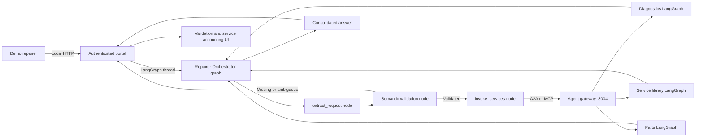
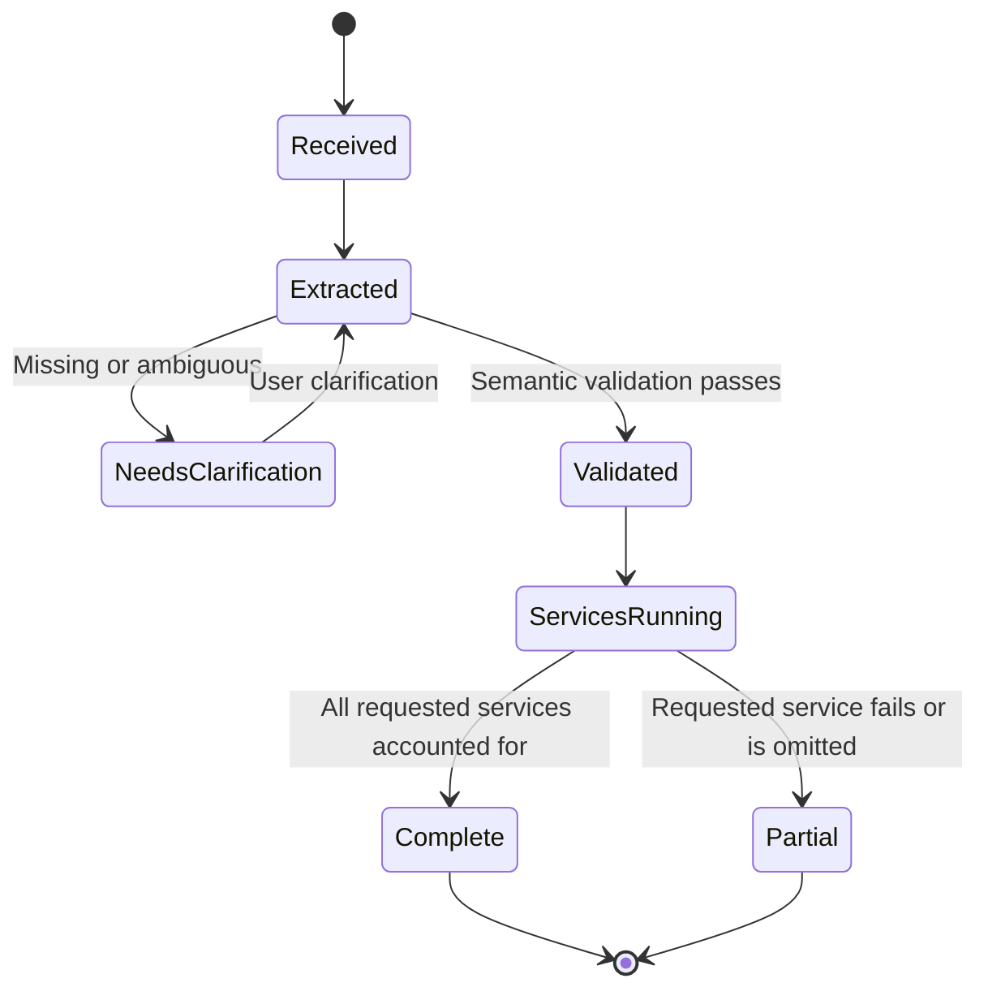

# Prototype Architecture

## Control boundaries

- The portal owns prototype authentication, browser sessions, conversation
  reset, request references, live health display, and response metadata.
- Request-scoped operational progress is emitted by the actual LangGraph nodes
  and remote-agent calls, then exposed only to the authenticated user's active
  session. It contains structured routing decisions and statuses, not hidden
  chain-of-thought or prompt content.
- SQLite owns durable user profiles, language preferences, conversations,
  messages, service history, and repair orders. Recent messages are supplied to
  every LangGraph turn, including after a portal restart.
- API authorization enforces `administrator` and `repairer` roles. Repairers
  remain scoped to their own records; administrators receive aggregate
  synthetic account statistics.
- Administrator conversation search uses parameterized literal substring
  matching across account metadata, messages, and globally unique repair-order
  references, with bounded result sets and a read-only transcript endpoint. It
  does not resume or mutate another user's LangGraph conversation.
- `data/llm_usage.db` stores model identifiers, call status, token counts,
  latency, and available cost estimates. It never stores prompt or response
  content. The dashboard combines it with service health and A2A/MCP routing.
- The LLM understands natural language and writes the conversational response.
- An independent semantic validation pass reviews the latest request, recent
  conversation, and extracted fields.
- Its response is constrained by a structured schema.
- Graph topology prevents remote service calls before validation.
- The orchestrator owns routing and receives every remote result.
- Remote agents remain independent LangGraph applications exposed through both
  A2A and MCP gateway interfaces.
- Each service tool validates structured input and returns a standard status.
- The portal independently accounts for requested versus actually called
  services and labels incomplete work as partial.

## Runtime processes

| Process | Address | Purpose |
|---|---|---|
| Repairer Portal | `127.0.0.1:8000` | Authentication, UI, LangGraph runner |
| Agent Gateway | `127.0.0.1:8004` | A2A sub-path routing and MCP tools |

## Memory boundaries

- Browser sessions and busy-request locks are deliberately in memory and expire
  when the portal restarts.
- Conversation content is durable in `data/portal.db` and keyed by account and
  conversation ID.
- The orchestrator receives at most the latest 20 stored messages per turn.
- This is conversational continuity, not an unbounded semantic-memory or vector
  retrieval system.

The registry at `repairer_orchestrator/service_agents.json` defines enabled
remote agents and their supported protocols. Every graph is available under an
A2A sub-path and as an MCP tool. The configured preferred protocol determines
the transport used for each call; returned statuses share one contract.

## Request lifecycle

The completed validation and service status are stored with the conversation and
service-history entry. Live progress events and in-flight LangGraph checkpoints
remain memory-only. See [KNOWN_LIMITATIONS.md](KNOWN_LIMITATIONS.md).
