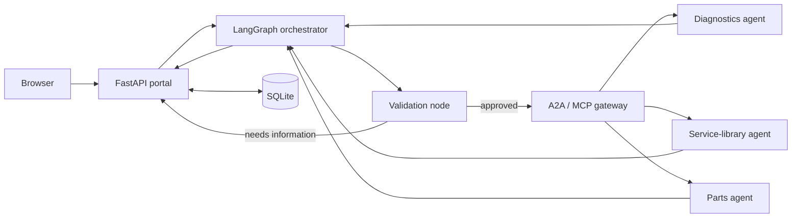

# Repairer Orchestrator

[](https://www.python.org/)
[](https://github.com/langchain-ai/langgraph)
[](#architecture)
[](https://fastapi.tiangolo.com/)
[](SETUP_WINDOWS.md)
[](LICENSE)

A local, synthetic reference implementation of a repair-domain multi-agent
system. The project demonstrates how a central LangGraph orchestrator can
validate a request, route work through an A2A/MCP gateway, combine structured
results, and present the outcome in a multilingual web portal.

> [!IMPORTANT]
> All vehicles, procedures, inventory records, accounts, and repair orders in
> this repository are fictional. This project is a software prototype, not a
> repair-authorisation or safety-critical diagnostic system.

## Highlights

- Explicit LangGraph orchestration with validation before remote delegation
- A2A agent discovery and MCP Streamable HTTP tools behind one gateway
- Three synthetic specialist agents: diagnostics, service library, and parts
- Structured outcomes such as `success`, `no_match`, `missing_information`,
  `invalid_request`, `temporary_failure`, and `internal_error`
- Multi-turn conversation context and durable SQLite history
- Repairer and administrator roles with scoped data access
- Multilingual portal with repair orders, service history, and theme switching
- Administrator telemetry for service health, routing, model usage, and cost
- Guardrails for prompt injection, privilege escalation, unrelated requests,
  unsafe actions, and access to another user's data
- Automated tests covering orchestration, protocols, persistence, and security

## Architecture



The orchestrator remains in control of every request. Remote services are
called only from explicit graph nodes after validation succeeds; they are not
embedded as autonomous subgraphs.

## Technology

- Python 3.12
- LangGraph 1.x
- FastAPI and Uvicorn
- Official A2A Python SDK
- Model Context Protocol (MCP)
- LiteLLM
- Pydantic and HTTPX
- SQLite
- Vanilla HTML, CSS, and JavaScript
- Pytest and Ruff

## Quick start on Windows

### 1. Create the environment

```powershell
py -3.12 -m venv .venv
.\.venv\Scripts\Activate.ps1
python -m pip install --upgrade pip setuptools wheel
python -m pip install -e ".[dev]"
```

### 2. Configure an LLM provider

```powershell
Copy-Item .env.example .env
```

Open `.env` and configure either an Azure OpenAI-compatible endpoint or Google
Gemini. Never commit `.env` or an API key.

### 3. Verify and start

```powershell
python -m pytest -v
python -m ruff check .
.\start_all.ps1
```

Open <http://127.0.0.1:8000>.

Synthetic demonstration accounts:

| Role | Username | Password |
|---|---|---|
| Repairer | `demo.repairer` | `Synthetic123!` |
| Administrator | `demo.admin` | `AdminSynthetic123!` |

These credentials are local and fictional. They are not suitable for a hosted
or production deployment.

## Example request

```text
For Demo Compact Hatchback in the EU, assess fault code P0301, find the
matching synthetic procedure, and check whether a synthetic ignition coil is
available. Consult every relevant service and consolidate the result.
```

The result identifies which services were selected, which protocol was used,
and whether each capability succeeded, returned no match, or failed. A fault
code is never treated as proof that a particular component has failed.

## Project layout

```text
agent_gateway/          A2A routes, agent cards, and MCP tools
common/                 Shared schemas, transports, logging, and telemetry
repairer_orchestrator/  LangGraph workflow, validation, and service registry
repairer_portal/        FastAPI application and browser interface
service_agents/         Synthetic specialist agents and datasets
scripts/                Health, preflight, and smoke-test utilities
tests/                  Automated test suite
```

## Documentation

| Document | Purpose |
|---|---|
| [Setup guide](SETUP_WINDOWS.md) | Installation, configuration, and troubleshooting |
| [Architecture](ARCHITECTURE.md) | Components, state, protocols, and control boundaries |
| [Demo guide](DEMO_GUIDE.md) | Repeatable walkthrough and expected outcomes |
| [Adding an agent](ADDING_SERVICE_AGENTS.md) | Extending the service registry and gateway |
| [A2A agent cards](A2A_AGENT_CARDS.md) | Discovery metadata and agent identity |
| [Error handling](ERROR_HANDLING.md) | Structured statuses and failure behaviour |
| [Guardrail tests](GUARDRAIL_TESTS.md) | Manual security and scope checks |
| [Known limitations](KNOWN_LIMITATIONS.md) | Prototype boundaries and production gaps |
| [Themes](THEMES.md) | Portal theme selection and restoration |

## Quality checks

```powershell
python -m pytest -v
python -m ruff check .
python -m ruff format --check .
python scripts/check_services.py
```

The service check expects the local gateway to be running.

## Security and data handling

- Prompts, generated text, API keys, cookies, and authorisation headers are not
  written to logs.
- Runtime databases, logs, secrets, caches, and virtual environments are
  excluded from version control.
- The bundled datasets and identities are synthetic.
- The local authentication and service-to-service connections are deliberately
  prototype-grade; review [Known limitations](KNOWN_LIMITATIONS.md) before any
  deployment work.

## Scope

This repository is intended for local learning, architecture exploration, and
demonstration. It requires additional identity, transport security, secret
management, observability, resilience, data governance, and safety review
before it could be considered for a shared environment.

## License

Released under the [MIT License](LICENSE).
